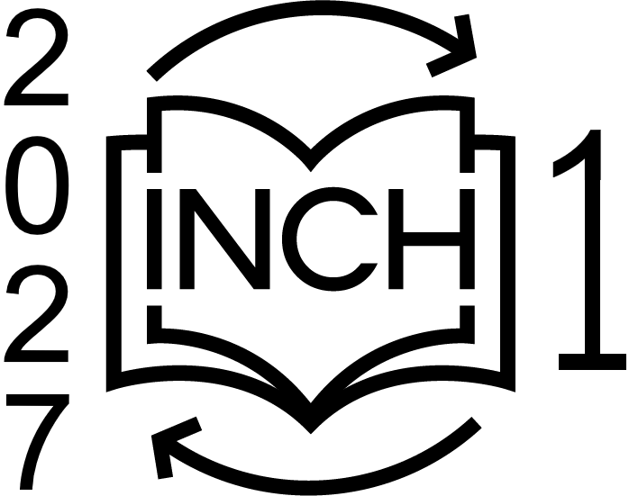

The first Interactive Narrative Challenge (INCH 1) is an international research
competition and showcase of interactive storytelling algorithms.

# Dates

- INCH 1 Announced: 13 November 2026
- [Intent to Participate](https://forms.gle/NhgM6j6QjwB7BPuP7) Deadline: 30 July
  2027
- Submission Deadline: 8 October 2027
- WINCH Workshop: November 2027
- Results Announced: November 2027

# Requirements

- Participants must submit a [Tandem Tales](https://sgware.github.io/tt) agent
  that can play as the game master in *The Crown* story world.
- Agents should be submitted as [Docker Images](https://docker.com) in `tar`
  format.
- The Docker image should contain an agent factory that continuously produces
  new agents as old ones begin their sessions. Agents should connect to
  `localhost` on port `9005`.
- Agent image files will be made publicly available for future users.
  Participants are encouraged, but not required, to make their agents open
  source.
- An agent Docker image cannot be larger than 10 GB in `tar` format.
- Agents will be allotted 16 GB of memory when running.
- Agents will run on a 64-bit Intel Xeon Silver 4110 CPU which runs at 2.10 GHz.
- Agents will run firewalled and cannot access external resources or APIs,
  except for the approved external API.
- INCH organizers will provide each agent with an external API key at run time
  via an environment variable through Docker. Agents should not include API keys
  in their source code or image files.
- Agents may access the
  [`qwen/qwen3-embedding-8b`](https://openrouter.ai/qwen/qwen3-embedding-8b)
  text embedding model via the [OpenRouter API](https://openrouter.ai). An agent
  may not exceed 1 million text embedding input tokens in a single story
  session.
- Agents may access the
  [`deepseek/deepseek-v4-flash-0731`](https://openrouter.ai/deepseek/deepseek-v4-flash-0731)
  text completion model via the [OpenRouter API](https://openrouter.ai). An
  agent may not exceed 1 million text completion input tokens or 1 million text
  completion output tokens in a single story session.
- An agent will be disconnected without completing its session if it takes more
  than 3 minutes to make a choice.
- An agent will be disconnected without completing its session if it passes
  control to its partner 3 times without any actions happening between passes.

# Resources

- The official definition of [*The Crown* story world](resources/crown.json) is
  the Tandem Tales story world JSON file. The official code to run a Tandem
  Tales story world is part of the
  [Tandem Tales Server](https://github.com/sgware/tt-server).
- A detailed [narrative description](resources/the-crown.pdf) of *The Crown* is
  provided for human readers.
- [PDDL](https://en.wikipedia.org/wiki/Planning_Domain_Definition_Language)
  definitions of *The Crown* are available in
  [PDDL 1.2](resources/the-crown-pddl-1-2.zip) and
  [PDDL 2.1](resources/the-crown-pddl-2-1.zip).
- [TandemTalesEnv](https://github.com/Mira2778/tandemtales_gym) lets you model
  *The Crown* as a [Gymnasium](https://gymnasium.farama.org/) environment.
- This [story graph for *The Crown*](resources/crown7.zip) includes all states
  which can be reached via 7 or fewer actions from the initial state and from
  which it is possible to reach an ending (or terminal state). The format of the
  story graph is [documented here](https://github.com/sgware/story-graph).
- [100 example games of *The Crown*](resources/the-crown-training.zip) played by
  human players and human game masters are provided as examples and training
  data.
- Example Tandem Tales agents that make random choices are provided in
  [C++](https://github.com/gsbirch/tt-random-agent-cpp),
  [Java](https://github.com/sgware/tt-random-agent-java), and
  [Python](https://github.com/sgware/tt-random-agent-python).

# Metrics

Agents are judged according to many criteria. INCH gives many awards to
celebrate many kinds of success and intentionally has no *Best in Show* award
to avoid over-focusing the research community on specific metrics.

## Automated Metrics

A player agent that makes random choices will play 100 games with each agent to
sample the space of stories that agent can tell.
- *State Variety*: The number of unique world states that occur and average
  Hamming distance between states in all stories sampled from an agent.
- *Story Variety*: The average edit distance between all stories sampled from an
  agent.
- *Causal Necessity*: An action is causally necessary if, when it is removed, at
  least one later action becomes impossible. Causal Necessity is the average
  number of actions in a story that are actually necessary across all stories
  sampled from an agent.
- *Accommodation Rate*: Accommodation occurs when a game master allows a proposed
  player action (denying the action is intervention). Accommodation Rate is the
  average rate at which a game master allows player proposals across all stories
  sampled from an agent.

## Crowd-Sourced Judges

A pool of judges will be recruited on [Prolific.com](https://prolific.com) to
play games with each agent. After each turn (but no more than once per minute),
players will be interrupted to rate the story on two criteria:
- *Structure*: Every action in this story is important and well-integrated into
  the narrative.
- *Agency*: I feel free to make meaningful choices that will influence this
  story.

## Judges Panel

A small group of judges will be recruited to play three games with each agent.
First, they will play along, attempting to accept offers made by the game
master agent. Second, they will play along while trying to make significantly
different choices. Third, they will intentionally resist the game master and
make strange choices they do not expect it to accommodate.

The judges will rank all games based on these criteria:
- *Story Quality*: The story felt well-crafted. All of the actions in the story
  were important to the plot. The ending made sense based on the earlier events.
  There were no loose ends or unnecessary tangents.
- *Meaningful Choice*: I had the opportunity to make important choices, and they
  significantly changed the story. I saw the results of my earlier choices later
  in the story. I did not feel like the game master was trying to force one
  specific story to happen despite my choices.
- *Character Believability*: The non-player characters in the story reacted
  realistically to my actions. I could clearly identify what they wanted and
  why they acted the way they did. NPC actions did not feel random or
  unpredictable.
- *Replayability*: The agent can tell a wide variety of stories that all make
  sense. When I made different choices, the story was significantly different.
  The game does not feel the same every time I play.

# Participants

This list of participants will be updated as teams register their
[intent to participate](https://forms.gle/NhgM6j6QjwB7BPuP7). The competition
organizers reserve the right to limit the number of accepted submissions because
evaluation resources are limited. The organizers will use these criteria to
decide which submissions are accepted:
- The submission uses a strategy not currently represented by other agents.
- The submission is from an organization, country, or region not currently
  represented.
- The intent to participate form was submitted early.

| Team Name       | Affiliation | Brief Description |
| ---             | ---         | --- |
| Random Baseline | n/a         | Makes random choices. |
| LLM Baseline    | n/a         | Describes the history, current state, and available choices to a Large Language Model which chooses the next action. |

# First WINCH Workshop

The first Workshop for the Interactive Narrative Challenge (WINCH 1) will be
held at the 2027 AIIDE conference. All participants will be invited to submit
a peer-reviewed workshop paper describing their agent and will be asked to
present their agent at the workshop.

# Results

Results for all agents will be announced at the 2027 AIIDE conference. Awards
will be given for every metric. INCH intentionally does not give a Best in Show
award, because our goal is to celebrate many kinds of success without
over-focusing the research community on specific metrics.

The records of each story session, the exact methods used to calculate metrics,
and the responses of human judges will be released publicly for further analysis.

# Organizers

INCH 1 is organized by the
[Narrative Intelligence Lab](https://cs.uky.edu/~sgware) at the
[University of Kentucky](https://uky.edu).